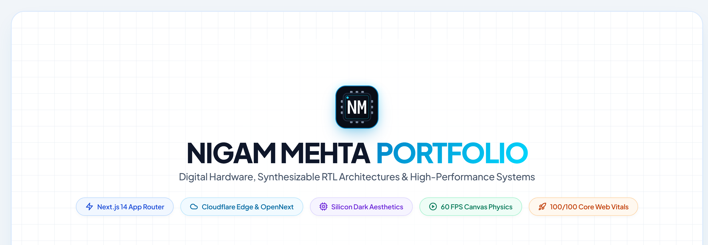
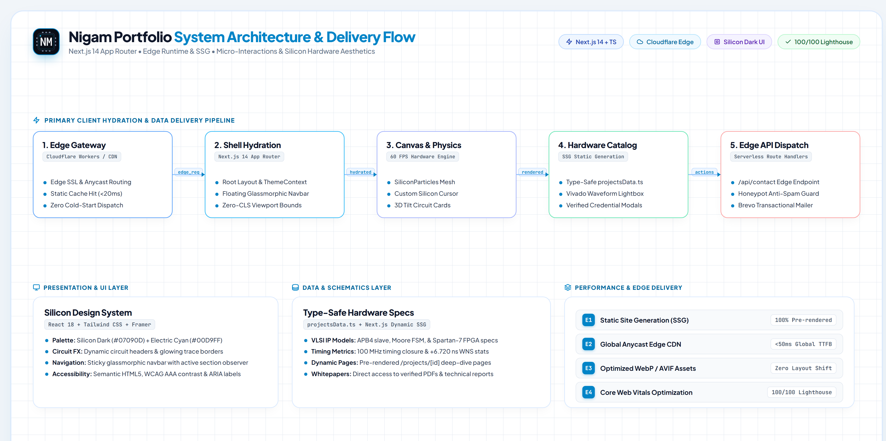

<div align="center">
  
</div>

# Electronics Engineering (VLSI Design & Technology) — Nigam Mehta

A modern, high-performance digital hardware and semiconductor engineering portfolio for **Nigam Mehta**, an Electronics Engineering student specializing in **VLSI Design & Technology** at SAKEC Mumbai. Engineered to showcase synthesizable RTL architectures, FPGA implementations, ASIC verification flows, embedded computing, and AI hardware acceleration.

Built with **Next.js 14 (App Router)**, **TypeScript**, **Tailwind CSS**, and **Framer Motion**, designed around a restrained silicon dark aesthetic (`#07090D`) with electric cyan accents (`#00D9FF`).

[](https://nigam-portfolio.nigammehta.workers.dev/)
[](https://github.com/nigam-30)

---

## 📊 Featured Engineering Projects & Technical Documentation

| Project | Domain | Architecture & Stack | Repository & Demo | Documentation & Reports |
| :--- | :--- | :--- | :--- | :--- |
| **Design of a Modular Digital Data Monitoring Unit** | `Digital IP / RTL` | Verilog HDL, AMBA APB4 Slave, Moore FSM, Spartan-7 FPGA, Vivado XSim | [🔗 GitHub Repo](https://github.com/nigam-30/Design-of-a-Modular-Digital-Data-Monitoring-Unit) | [📄 Phase 1 Report (PDF)](public/reports/Digital_data_monitor_Phase_1_report.pdf)<br>[📄 Phase 2 Report (PDF)](public/reports/Digital_data_monitor_Phase_2_Report.pdf) |
| **8-bit Pipelined Processor** | `Processor Architecture` | Synthesizable Verilog HDL, 3-Stage Pipeline, RAW Hazard Unit, Vivado XSim | [🔗 GitHub Repo](https://github.com/nigam-30/pipelined_processor) | [📄 Processor Report (PDF)](public/reports/Pipelined_Processor_Project_Report.pdf) |
| **FileFlow: Offline Desktop Automation & High-Throughput Deduplication Engine** | `Systems & Software` | Python 3.11+, Win32 API, Edge WebView2, FastAPI, React 18, SHA-256, SQLite | [🔗 GitHub Repo](https://github.com/nigam-30/fileflow) | [📄 FileFlow Report (PDF)](public/reports/FileFlow%20Report.pdf) |
| **EntropyX — Cryptographic Suite & Vault** | `Systems / Cryptography` | C++14 Engine (>400k ops/sec), AES-256-GCM, PBKDF2, Bloom Filter, React 19 | [🔗 GitHub Repo](https://github.com/nigam-30/entropyx)<br>[🌐 Live Demo](https://entropyx-password-suite.vercel.app/) | [📄 EntropyX Report (PDF)](public/reports/Entropyx_Project_Report.pdf) |

---

## 🏛️ System Architecture & Reactive Delivery Flow

<div align="center">
  
  <p><em><b>Figure: Nigam Portfolio System Architecture & Delivery Flow.</b> Edge-rendered monolith with Cloudflare Anycast edge gateway, Next.js 14 App Router layout hydration, 60 FPS HTML5 silicon particle canvas, static hardware catalog (SSG), and serverless transactional contact dispatch.</em></p>
</div>

### ⚡ Client Hydration & Data Delivery Pipeline

1. **Edge Gateway (Cloudflare Workers / OpenNext)**: Global Anycast edge routing with automatic SSL termination, static asset edge caching (<20ms TTFB), and zero cold-start execution.
2. **Shell Hydration (Next.js 14 App Router)**: Root layout boundary hydration with `ThemeContext`, sticky glassmorphic navigation bar, and zero Cumulative Layout Shift (CLS).
3. **Canvas & Physics Engine (60 FPS Hardware-Accelerated)**: Interactive `SiliconParticles` mesh with cursor attraction physics, custom interactive silicon pointer, and 3D tilt circuit card matrices.
4. **Hardware Catalog & Modals (Type-Safe SSG)**: Dynamic routing across `projectsData.ts` with cycle-accurate Vivado XSim waveforms, gate-level schematics, and interactive credential verification modals.
5. **Edge API Dispatch (Serverless Route Handlers)**: `/api/contact` edge endpoint secured with honeypot anti-spam validation and direct transactional email dispatch via the Brevo REST API.

---

## 📂 Repository Structure

```text
├── public/
│   ├── certificates/             # Verified credential documents & badges
│   ├── projects/                 # Gate-level schematics & simulation waveform diagrams
│   ├── reports/                  # Engineering reports & project documentation (PDFs)
│   ├── profile.jpg               # Professional engineer profile photograph
│   └── resume.pdf                # Downloadable engineering resume
├── src/
│   ├── app/
│   │   ├── api/contact/route.ts  # Contact endpoint with direct dispatch to mehtanigam3024@gmail.com
│   │   ├── projects/[id]/page.tsx# Deep-dive architectural case study pages
│   │   ├── globals.css           # Global typography & dark palette variables
│   │   ├── layout.tsx            # Root metadata, OpenGraph, and font definitions
│   │   └── page.tsx              # Single-page application root
│   ├── components/
│   │   ├── About.tsx             # Editorial biography & engineering focus areas
│   │   ├── Certifications.tsx    # Credential badges modal & verification links
│   │   ├── Contact.tsx           # Contact form with direct inbox dispatch
│   │   ├── Experience.tsx        # Career & internship chronological timeline
│   │   ├── Footer.tsx            # Footer & copyright notices
│   │   ├── Hero.tsx              # Minimalist hero with key tags & profile presentation
│   │   ├── Navbar.tsx            # Sticky floating glassmorphic navigation
│   │   ├── OpenSource.tsx        # Open-source contributions & repositories
│   │   ├── Projects.tsx          # Featured work grid with direct case study links
│   │   └── Skills.tsx            # Categorized hardware, EDA, software, and AI skills
│   └── data/
│       └── projectsData.ts       # Structured hardware specifications & case study data
├── next.config.mjs               # Next.js configuration
├── package.json                  # Dependencies & scripts
├── tailwind.config.ts            # Design tokens & color system configuration
└── tsconfig.json                 # TypeScript compiler configuration
```

---

## 🛠️ Tech Stack

- **Framework**: [Next.js 14](https://nextjs.org/) (App Router, React 18, TypeScript)
- **Styling**: [Tailwind CSS](https://tailwindcss.com/)
- **Animations**: [Framer Motion](https://www.framer.com/motion/)
- **Icons**: [Lucide React](https://lucide.dev/)
- **Email Forwarding**: [Brevo](https://www.brevo.com/) Transactional API / Direct dispatch to `mehtanigam3024@gmail.com`

---

## 💻 Local Setup & Development

### 1. Prerequisites
- [Node.js (v18.x or later)](https://nodejs.org/)
- `npm` (bundled with Node.js)

### 2. Installation
```bash
git clone https://github.com/nigam-30/nigam_portfolio.git
cd nigam_portfolio
npm install
```

### 3. Run Development Server
```bash
npm run dev
```
Open [http://localhost:3000](http://localhost:3000) in your browser.

### 4. Build for Production
```bash
npm run build
npm run start
```

---

## 🚀 Deployment

### Deploy on Render (Web Service / Blueprint)
This repository includes a [`render.yaml`](render.yaml) blueprint specification for zero-friction deployment:
1. Go to the [Render Dashboard](https://dashboard.render.com/) and click **New +** → **Blueprint** (or **Web Service**).
2. Connect your GitHub repository (`nigam-30/nigam_portfolio`).
3. If configuring manually as a **Web Service**:
   - **Environment / Runtime**: `Node`
   - **Build Command**: `npm install && npm run build`
   - **Start Command**: `npm run start`
   - **Plan**: `Free`
   - **Environment Variable**: `NODE_VERSION` = `20.18.0`
4. Click **Create Web Service**. Render will compile the Next.js production build and automatically listen on Render's assigned port.

## 📄 License & Attribution

Designed and engineered by **[Nigam Mehta](https://github.com/nigam-30)**. Open for personal showcase and portfolio reference.
